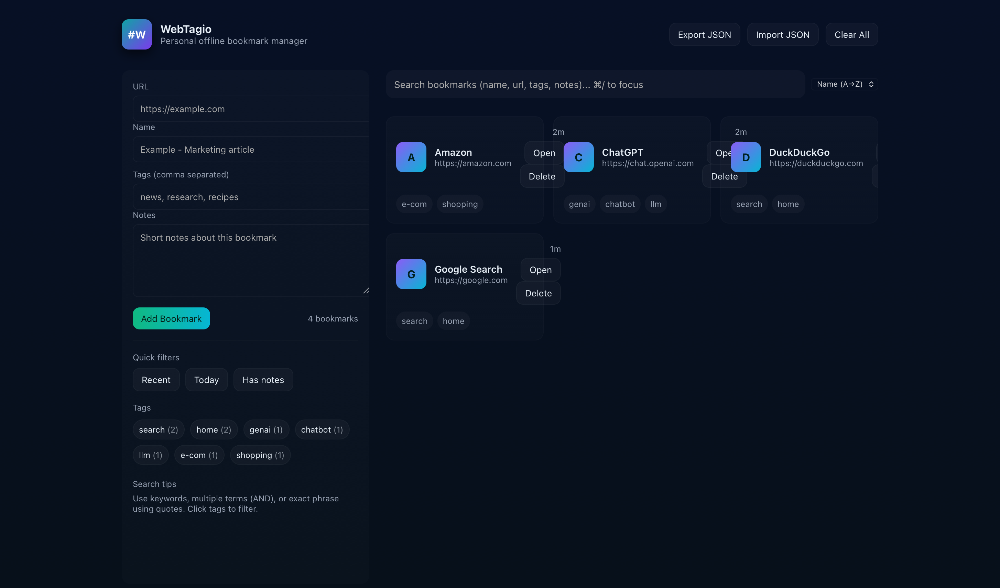

# webtagio
Tag everything on the web.

## Features

- Manage website bookmarks and tags completely offline in your own browser, but better visualized.
- Easily search and open the bookmark that you are looking for.
- Tag bookmarks for easy search.
- Offline, browser-based data storage, so fully private. (**Caution:** _Manage browser data, keep backup in case browser data is cleared._)

# Notice

Created by: Meet Vekaria
(Attribution required)
